# Enterprise Portfolio Database Architecture & ERD Reference

**Document Status**: Official Architecture Document  
**Version**: 1.0.0  
**Stack**: PostgreSQL 16+, Prisma ORM 6+, TypeScript, Node.js  
**Lead Engineer / Owner**: Said Khan  

---

## 1. Schema Conventions & Design Standards

### 1.1 Identifier (ID) Strategy: CUID
Every table in the database uses a string primary key generated via **CUID** (`@default(cuid())`):
- **Why CUID over Auto-Increment (Serial / Int)**: Sequential integers expose row counts, leak business metrics, and enable ID enumeration / scraper scraping attacks.
- **Why CUID over UUIDv4**: CUID is URL-safe, compact, horizontally scalable, collision-resistant in distributed environments, and starts with a timestamp prefix providing pseudo-chronological ordering (improving B-Tree index clustering in PostgreSQL).

### 1.2 Naming Conventions
- **Prisma Models**: Defined in singular `PascalCase` (e.g. `User`, `BlogPost`, `SiteSetting`, `ProjectClick`).
- **Prisma Fields**: Defined in `camelCase` (e.g. `shortDescription`, `publishedAt`, `ipHash`, `techStack`).
- **Database Tables**: Explicitly mapped to plural `snake_case` using Prisma's `@@map` attribute:
  - `User` -> `@@map("users")`
  - `Session` -> `@@map("sessions")`
  - `SiteSetting` -> `@@map("site_settings")`
  - `Project` -> `@@map("projects")`
  - `Category` -> `@@map("categories")`
  - `Skill` -> `@@map("skills")`
  - `Service` -> `@@map("services")`
  - `Experience` -> `@@map("experiences")`
  - `Education` -> `@@map("educations")`
  - `Testimonial` -> `@@map("testimonials")`
  - `BlogPost` -> `@@map("blog_posts")`
  - `Tag` -> `@@map("tags")`
  - `ContactMessage` -> `@@map("contact_messages")`
  - `Media` -> `@@map("media")`
  - `PageView` -> `@@map("page_views")`
  - `ProjectClick` -> `@@map("project_clicks")`
  - `ResumeDownload` -> `@@map("resume_downloads")`
- **Foreign Keys**: Explicitly suffixed with `Id` in camelCase (e.g., `userId`, `categoryId`, `projectId`).

### 1.3 Timestamps & Auditability
Every table without exception defines:
- `createdAt DateTime @default(now()) @db.Timestamptz`: Audit record of creation time.
- `updatedAt DateTime @updatedAt @db.Timestamptz`: Automatically updated by Prisma and PostgreSQL triggers upon mutation.

### 1.4 Soft Delete (`deletedAt`) Policy
- **Scope**: Applied to high-value content models (`Project`, `BlogPost`).
- **Implementation**: A nullable timestamp field `deletedAt DateTime? @db.Timestamptz`.
- **Query Filtering**: Standard queries automatically exclude rows where `deletedAt != null` using a custom Prisma Client Extension. Admin queries can explicitly opt-in with `{ includeDeleted: true }`.
- **Hard Deletes**: Allowed for ephemeral sessions (`Session`), cascaded telemetry (`ProjectClick`), or user contact messages upon manual purge.

### 1.5 Decimal, Numeric & JSON Usage Rules
- **Integers (`Int`)**: Used for counters (`viewCount`, `readingTime`), ordering (`order`), ratings (`rating` 1-5), levels (`level` 0-100), and file sizes (`size` in bytes).
- **JSON (`Json`)**: Restricted to polymorphic or key-value structures where creating a relational table would be unnecessary overhead (e.g. `SiteSetting.socialLinks`). All JSON columns must be strictly validated by Zod at the application boundary on read and write.
- **Text (`@db.Text`)**: Used for long-form content (blog Markdown, bios, full project descriptions, and message bodies).

---

## 2. Enums Reference

| Enum Name | Values | Purpose |
|---|---|---|
| `Role` | `ADMIN` | Single-admin access control role |
| `ContentStatus` | `DRAFT`, `PUBLISHED` | Publication lifecycle for Projects & Blog Posts |
| `MediaType` | `IMAGE`, `PDF`, `OTHER` | Classification of uploaded Cloudinary digital assets |
| `ClickType` | `LIVE`, `GITHUB`, `DETAILS` | Outbound and interaction project telemetry |
| `MessageStatus` | `NEW`, `READ`, `REPLIED`, `SPAM` | Triage lifecycle for incoming contact form inquiries |

---

## 3. Relationships & Cascade Behaviors

1. **`Session` -> `User` (Many-to-One)**:
   - Foreign key: `sessions.userId` -> `users.id`
   - Cascade: `onDelete: Cascade` (Deleting an admin user automatically purges all their active sessions).
2. **`Project` -> `Category` (Many-to-One)**:
   - Foreign key: `projects.categoryId` -> `categories.id`
   - Cascade: `onDelete: SetNull` (Deleting a category preserves the project with `categoryId: null`).
3. **`BlogPost` <-> `Tag` (Many-to-Many)**:
   - Implicit Prisma join table: `_BlogPostToTag`
   - Both entities can be linked or unlinked without affecting each other.
4. **`ProjectClick` -> `Project` (Many-to-One)**:
   - Foreign key: `project_clicks.projectId` -> `projects.id`
   - Cascade: `onDelete: Cascade` (Purging a project permanently purges associated click logs).

---

## 4. Full Entity Relationship Diagram (ERD)

```mermaid
erDiagram
    User ||--o{ Session : "authenticates"
    Category ||--o{ Project : "classifies"
    Project ||--o{ ProjectClick : "generates"
    BlogPost }o--o{ Tag : "tagged_with"

    User {
        string id PK "cuid"
        string name
        string email UK "unique"
        string passwordHash
        Role role "ADMIN"
        datetime lastLoginAt
        int failedLoginCount
        datetime lockedUntil
        datetime createdAt
        datetime updatedAt
    }

    Session {
        string id PK "cuid"
        string userId FK "users.id"
        string tokenHash UK "sha256"
        datetime expiresAt
        string ipHash
        string userAgent
        datetime createdAt
    }

    SiteSetting {
        string id PK "default"
        string heroTitle
        string heroSubtitle
        string bio
        string email
        string phone
        string location
        json socialLinks
        string resumeUrl
        string defaultSeoTitle
        string defaultSeoDescription
        string defaultOgImage
        datetime createdAt
        datetime updatedAt
    }

    Category {
        string id PK "cuid"
        string name UK
        string slug UK
        datetime createdAt
        datetime updatedAt
    }

    Project {
        string id PK "cuid"
        string title
        string slug UK
        string shortDescription
        string fullDescription
        string thumbnailUrl
        string[] images
        string[] techStack
        string liveUrl
        string githubUrl
        string categoryId FK "categories.id"
        boolean isFeatured
        int order
        ContentStatus status "DRAFT | PUBLISHED"
        datetime publishedAt
        datetime deletedAt
        datetime createdAt
        datetime updatedAt
    }

    Skill {
        string id PK "cuid"
        string name
        int level "0 to 100"
        string category
        string icon
        int order
        boolean isVisible
        datetime createdAt
        datetime updatedAt
    }

    Service {
        string id PK "cuid"
        string title
        string description
        string icon
        int order
        boolean isVisible
        datetime createdAt
        datetime updatedAt
    }

    Experience {
        string id PK "cuid"
        string title
        string company
        string location
        datetime startDate
        datetime endDate
        boolean isCurrent
        string description
        int order
        datetime createdAt
        datetime updatedAt
    }

    Education {
        string id PK "cuid"
        string degree
        string institute
        datetime startDate
        datetime endDate
        string description
        int order
        datetime createdAt
        datetime updatedAt
    }

    Testimonial {
        string id PK "cuid"
        string clientName
        string clientRole
        string company
        string message
        string avatarUrl
        int rating "1 to 5"
        boolean isApproved
        int order
        datetime createdAt
        datetime updatedAt
    }

    Tag {
        string id PK "cuid"
        string name UK
        string slug UK
        datetime createdAt
        datetime updatedAt
    }

    BlogPost {
        string id PK "cuid"
        string title
        string slug UK
        string excerpt
        string content
        string coverImageUrl
        ContentStatus status "DRAFT | PUBLISHED"
        datetime publishedAt
        string seoTitle
        string seoDescription
        int readingTime
        int viewCount
        datetime deletedAt
        datetime createdAt
        datetime updatedAt
    }

    ContactMessage {
        string id PK "cuid"
        string name
        string email
        string subject
        string message
        MessageStatus status "NEW | READ | REPLIED | SPAM"
        string ipHash
        string userAgent
        datetime createdAt
        datetime updatedAt
    }

    Media {
        string id PK "cuid"
        string url
        string publicId UK
        MediaType type "IMAGE | PDF | OTHER"
        string mimeType
        int size
        int width
        int height
        string alt
        string folder
        datetime createdAt
        datetime updatedAt
    }

    PageView {
        string id PK "cuid"
        string path
        string referrer
        string country
        string device
        string visitorHash
        datetime createdAt
    }

    ProjectClick {
        string id PK "cuid"
        string projectId FK "projects.id"
        ClickType type "LIVE | GITHUB | DETAILS"
        datetime createdAt
    }

    ResumeDownload {
        string id PK "cuid"
        string visitorHash
        datetime createdAt
    }
```



---

## 5. Security & Privacy Data Enforcements
1. **Passphrase Protection**: Passwords are never stored in plaintext or reversible formats; they are hashed via Argon2id with memory-hard cost parameters.
2. **Session Token Privacy**: Session cookies transmit a random cryptographic token; only its SHA-256 hash (`tokenHash`) is indexed and queried in the database.
3. **Telemetry Anonymization**: IP addresses are never persisted in raw format; an irreversible SHA-256 hash with daily/static salt is stored (`ipHash`, `visitorHash`).
4. **90-Day Retention**: Analytical event tables (`PageView`, `ProjectClick`, `ResumeDownload`) are periodically pruned of records older than 90 days.

---

## 6. Migration Lifecycle & Operational Runbook

### 6.1 Strict Production Rule: Migrations Only
> [!CAUTION]
> **`prisma db push` is strictly forbidden in staging and production environments.**  
> Schema changes must be tracked in version control as immutable SQL files in `prisma/migrations/`.

### 6.2 Available Database Scripts (`package.json`)

| Command | Action | Environment |
|---|---|---|
| `npm run db:generate` | Generates TypeScript Prisma Client types | Dev, Build, Prod |
| `npm run db:migrate` | Generates & executes new migration locally | Local Dev only |
| `npm run db:deploy` | Executes pending migrations via `DIRECT_URL` | Staging & Production |
| `npm run db:status` | Validates migration history and checks for schema drift | All environments |
| `npm run db:studio` | Launches web UI for visual data browsing | Local Dev |
| `npm run db:seed` | Executes idempotent database seeding script | Dev & Setup |
| `npm run db:reset` | Wipes & re-migrates database (with safety check) | Local Dev only |

### 6.3 Creating a New Migration (Local Development)
1. Modify `prisma/schema.prisma` with your desired model changes.
2. Run the migration command with a descriptive snake_case name:
   ```bash
   npm run db:migrate -- --name add_feature_tables
   ```
3. Prisma will generate a new directory under `prisma/migrations/<timestamp>_<name>/migration.sql` and apply it to your local database.
4. Review the generated `migration.sql` file. If custom constraints (e.g., CHECK constraints) or triggers are needed, append them directly to this file.
5. Commit the migration directory to git.

### 6.4 Applying Migrations in Production (CI/CD Pipeline)
In your production deployment build step or container startup entrypoint:
```bash
npm run db:deploy
```
- **Connection Pooling Note**: When using pooled hosts (like Supabase Transaction Pooler or Neon PgBouncer), always configure `DIRECT_URL` pointing to port 5432 (direct session mode) for migrations, while `DATABASE_URL` uses the pooler (port 6543) for runtime queries.

### 6.5 Failure Recovery Runbook (Troubleshooting Failed Migrations)
If a migration fails in production due to a constraint or data conflict:
1. Check the migration status:
   ```bash
   npm run db:status
   ```
2. Identify the failed migration name. If the migration was partially applied and failed halfway:
   - If the database was rolled back automatically, mark it as rolled back:
     ```bash
     npx prisma migrate resolve --rolled-back "20261116120000_failed_migration"
     ```
   - If you manually fixed the underlying SQL issue in the production database:
     ```bash
     npx prisma migrate resolve --applied "20261116120000_failed_migration"
     ```
3. Apply a forward fix: never delete or rewrite existing migrations in production. Generate a new migration that applies the fix cleanly.

---

## 7. Performance & Query Optimization Architecture

### 7.1 Connection Pooling Strategy
- **Application Runtime (`DATABASE_URL`)**: Connects to the pooled connection endpoint (e.g., PgBouncer transaction mode / Supabase port 6543 / Neon connection pooling). Maximizes high-concurrency throughput without exhausting database worker threads.
- **Migration & Admin CLI (`DIRECT_URL`)**: Declared via `directUrl = env("DIRECT_URL")` in `prisma/schema.prisma`. Connects directly to PostgreSQL port 5432 (session mode) to support transactional DDL, schema locks, and advisory migration locks.

### 7.2 Observability & Slow Query Detection (200ms+ Threshold)
- **Pino Structured Logging**: Configured via Prisma Client event emitter (`$on('query')`).
- **Development**: Emits `logger.debug` for all executed queries with runtime in milliseconds.
- **Production & All Environments**: Queries taking $\ge 200\text{ ms}$ emit high-priority `logger.warn` and dispatch alert payloads to **Sentry** (`captureMessage(..., 'warning')`).
- **Database Errors**: Prisma errors (`$on('error')`) automatically trigger `logger.error` and Sentry error captures (`captureException`).

### 7.3 N+1 Query Elimination
- Relationships are eagerly fetched using batch relations (`include: { category: { select: ... } }`, `include: { tags: { select: ... } }`).
- Category project counts utilize Prisma's native `_count` aggregation (`LEFT JOIN` / `GROUP BY`) rather than per-row count loops.

### 7.4 Query Execution Plan (EXPLAIN ANALYZE) Benchmarks
1. **Published Projects List**:
   - `SELECT ... FROM "Project" WHERE "deletedAt" IS NULL AND "status" = 'PUBLISHED' ORDER BY "order" ASC, "createdAt" DESC LIMIT 20;`
   - **Index Utilized**: `Project_featured_status_idx` (Bitmap Index Scan).
   - **Execution Time**: `~0.169 ms`.
2. **Blog Posts by Tag**:
   - `SELECT b.* FROM "BlogPost" b JOIN "_BlogPostTags" bt ON b."id" = bt."A" JOIN "Tag" t ON bt."B" = t."id" WHERE b."deletedAt" IS NULL AND b."status" = 'PUBLISHED' AND t."slug" = $1 ORDER BY b."createdAt" DESC LIMIT 20;`
   - **Index Utilized**: `Tag_slug_idx` + `_BlogPostTags_B_index` + `BlogPost_pkey` (Nested Loop Index Scan).
   - **Execution Time**: `~0.106 ms`.
3. **Analytics by Date Range**:
   - `SELECT "path", COUNT("path") FROM "PageView" WHERE "createdAt" >= NOW() - INTERVAL '30 days' GROUP BY "path" ORDER BY COUNT("path") DESC LIMIT 10;`
   - **Index Utilized**: `PageView_path_createdAt_idx` (**Index Only Scan**).
   - **Execution Time**: `~0.124 ms`.

---

## 8. Security Architecture & Least-Privilege Policies

### 8.1 Production SSL Enforcement
- The environment validation layer (`src/lib/env.ts`) actively verifies `DATABASE_URL` and `DIRECT_URL` in production (`NODE_ENV === 'production'`).
- The server refuses to boot if the connection string lacks SSL enforcement (`sslmode=require`, `sslmode=verify-full`, or `ssl=true`).

### 8.2 Database Role Separation (Least-Privilege RBAC)
PostgreSQL access is partitioned into two distinct roles managed via `scripts/least-privilege-roles.sql`:

| Role Name | Scope | Capabilities | Restrictions |
|---|---|---|---|
| `portfolio_migrator` | CI/CD / Migrations | Full DDL & DML (`CREATE TABLE`, `ALTER TABLE`, `DROP TABLE`, `CREATE INDEX`) | Only used during deployment pipelines via `DIRECT_URL` |
| `portfolio_app` | Runtime Application | Data Manipulation Only (`SELECT`, `INSERT`, `UPDATE`, `DELETE`) | Strictly **NO DDL**: `REVOKE CREATE ON SCHEMA public`, `REVOKE TRUNCATE` |

```sql
-- Application runtime user configuration
CREATE ROLE portfolio_app WITH LOGIN PASSWORD 'change_this_app_password_in_prod';
GRANT CONNECT ON DATABASE portfolio_backend_db TO portfolio_app;
GRANT USAGE ON SCHEMA public TO portfolio_app;
GRANT SELECT, INSERT, UPDATE, DELETE ON ALL TABLES IN SCHEMA public TO portfolio_app;
GRANT USAGE, SELECT ON ALL SEQUENCES IN SCHEMA public TO portfolio_app;

-- Explicitly revoke DDL & destructive operations
REVOKE CREATE ON SCHEMA public FROM portfolio_app;
REVOKE TRUNCATE ON ALL TABLES IN SCHEMA public FROM portfolio_app;
```

### 8.3 Sensitive Data Encryption & Sanitization
1. **User Passwords**: Stored strictly as **Argon2id** hashes with high computational cost (`memoryCost: 65536, timeCost: 3, parallelism: 4`). Passwords are never logged or stored in plain text.
2. **Session Authentication**: Tokens generated with 32 bytes of cryptographically secure random entropy (`crypto.randomBytes(32)`). Only the SHA-256 hash (`tokenHash`) is persisted in PostgreSQL.
3. **Visitor IP Privacy**: IP addresses are never stored in raw form. All analytics records (`PageView`, `ProjectClick`, `ContactMessage`) store a one-way SHA-256 hash combined with a 32-character secret salt (`ANALYTICS_SALT`).
4. **Secret Hygiene**: `.env` files are tracked in `.gitignore`. `.env.example` contains only sanitized non-production placeholders.

---

## 9. Disaster Recovery, Backup & Restore Runbook

### 9.1 Backup Architecture
1. **Cloud Provider Automated Backups**:
   - Point-in-Time Recovery (PITR) with continuous WAL archiving (e.g., Supabase / Neon / AWS RDS).
   - Daily automated disk snapshots retained for 30 days.
2. **Offsite Cold Storage Dumps**:
   - Nightly scheduled job executing `pg_dump` with custom compression format (`-Fc`).
   - Backup archives are encrypted with GPG and uploaded to an independent S3-compatible cloud bucket (e.g., Cloudflare R2 / AWS S3).
   - **Retention Schedule**: Daily dumps retained for 30 days; weekly snapshots retained for 90 days.

### 9.2 Step-by-Step Restoration Procedure
To restore a backup into a fresh or recovered database:

1. **Download and verify backup artifact**:
   ```bash
   # Retrieve latest backup from secure offsite storage
   aws s3 cp s3://portfolio-db-backups/daily/portfolio_backup_latest.dump /tmp/portfolio_backup.dump
   ```
2. **Provision or prepare target database**:
   ```bash
   createdb -U postgres portfolio_backend_db
   ```
3. **Execute pg_restore**:
   ```bash
   pg_restore -U postgres -d portfolio_backend_db --clean --if-exists --no-owner --no-privileges /tmp/portfolio_backup.dump
   ```
4. **Verify data integrity & table counts**:
   ```bash
   psql -U postgres -d portfolio_backend_db -c "SELECT count(*) FROM \"User\"; SELECT count(*) FROM \"Project\";"
   ```
5. **Reapply least-privilege roles**:
   ```bash
   psql -U postgres -d portfolio_backend_db < scripts/least-privilege-roles.sql
   ```
6. **Apply pending migrations**:
   ```bash
   npm run db:deploy
   ```

---

## 10. Complete Model Dictionary (17 Models)

| # | Model Name | Database Table | One-Line Purpose |
|---|---|---|---|
| 1 | `User` | `users` | Authenticated administrator account with Argon2id password hash and lockout guards. |
| 2 | `Session` | `sessions` | Active administrator login sessions with SHA-256 token hashes and expiration dates. |
| 3 | `SiteSetting` | `site_settings` | Singleton entity storing global portfolio configuration, bio, social links, and SEO defaults. |
| 4 | `Category` | `categories` | Project domain classification taxonomy (e.g., Backend, Distributed Systems, Cloud). |
| 5 | `Project` | `projects` | Portfolio showcase items with full Markdown descriptions, demo/repo URLs, and soft delete. |
| 6 | `BlogPost` | `blog_posts` | Long-form technical engineering articles with reading time, SEO metadata, and soft delete. |
| 7 | `Tag` | `tags` | Keywords associated with blog posts via an implicit many-to-many relationship. |
| 8 | `Skill` | `skills` | Professional skills with categorized levels (0-100 enforced by CHECK constraint). |
| 9 | `Service` | `services` | Client offerings and system architecture consulting packages with feature lists. |
| 10 | `Experience` | `experiences` | Career history records with company, role, date ranges, and technologies used. |
| 11 | `Education` | `educations` | Academic qualifications, degrees, institutions, and date ranges. |
| 12 | `Testimonial` | `testimonials` | Endorsements with rating (1-5 enforced by CHECK constraint) and moderation approval workflow. |
| 13 | `ContactMessage` | `contact_messages` | Inbound contact form submissions with spam classification and triage status flags. |
| 14 | `Media` | `media` | Cloudinary asset registry storing public IDs, format dimensions, folders, and alt text. |
| 15 | `PageView` | `page_views` | Anonymized visitor telemetry with salted SHA-256 IP hashes and 90-day retention. |
| 16 | `ProjectClick` | `project_clicks` | Interaction events on project external links (Live, GitHub, Demo) with cascade deletion. |
| 17 | `ResumeDownload` | `resume_downloads` | Anonymized tracking of visitor resume/CV PDF download events. |

---

## 11. Common Problems & Troubleshooting Runbook

### 11.1 Error: `P1000: Authentication failed against database server`
- **Cause**: The credentials (username or password) in `DATABASE_URL` or `DIRECT_URL` are incorrect, or the user lacks permission on the target database.
- **Solution**:
  1. Verify credentials by connecting manually via `psql`:
     ```bash
     psql -h localhost -U portfolio_user -d portfolio_backend_db
     ```
  2. Verify that `DIRECT_URL` and `DATABASE_URL` in `.env` match the actual PostgreSQL configuration.

### 11.2 Error: `P2002: Unique constraint failed on the fields: (...)`
- **Cause**: An attempt was made to insert a record with a duplicate unique field (`slug`, `email`, or `tokenHash`).
- **Solution**: The application layer catches `P2002` via `src/lib/errors.ts` and maps it to a `ConflictError` (HTTP 409). For slugs, append a random suffix or timestamp (e.g., `${baseSlug}-${Date.now()}`).

### 11.3 Error: `P2025: An operation failed because it depends on one or more records that were required but not found`
- **Cause**: Attempting to update or delete a record that does not exist or has already been soft-deleted.
- **Solution**: Mapped to `NotFoundError` (HTTP 404). Always verify existence via `findFirst` or use upsert patterns.

### 11.4 Error: `P3005: The database schema is not empty`
- **Cause**: Running `prisma migrate deploy` on an existing database that was created without Prisma migration history.
- **Solution**: Baseline the migration history by telling Prisma the initial migration has already been applied:
  ```bash
  npx prisma migrate resolve --applied "20261116120000_init_portfolio_schema"
  ```

### 11.5 Error: `ERROR: permission denied for schema public`
- **Cause**: The application runtime role (`portfolio_app`) was used to execute DDL (`CREATE TABLE`, `ALTER TABLE`, `DROP TABLE`).
- **Solution**: DDL must always be run using the migration role (`portfolio_migrator` or `postgres`) via `DIRECT_URL`. The runtime user `portfolio_app` is intentionally restricted to DML (`SELECT`, `INSERT`, `UPDATE`, `DELETE`) only.

### 11.6 Production Server Boot Rejection: `DATABASE_URL must require SSL`
- **Cause**: Running in production (`NODE_ENV=production`) with a connection string lacking SSL parameters.
- **Solution**: Append `?sslmode=require` to both `DATABASE_URL` and `DIRECT_URL` in production environment secrets.


